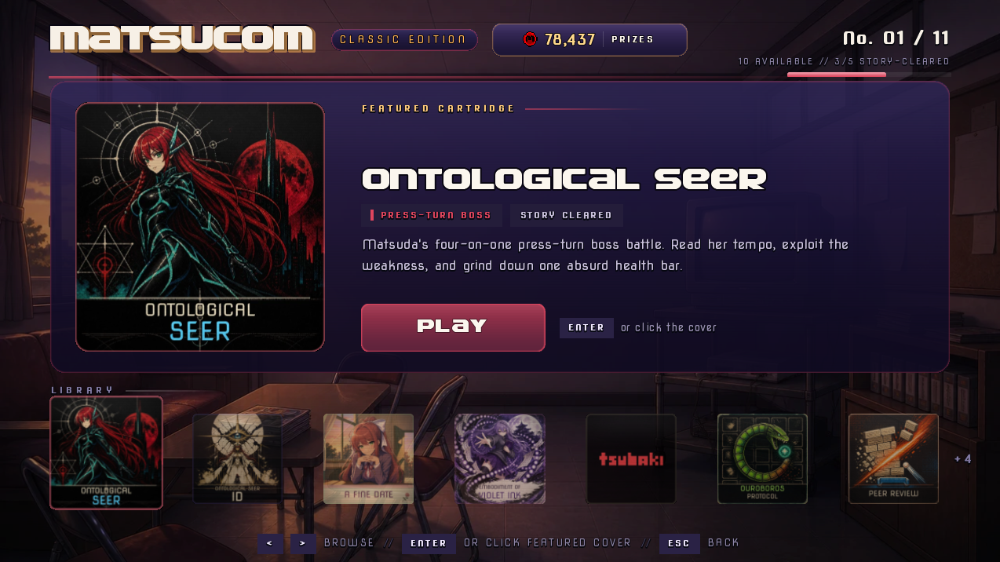

# Ontological Seer card braid correction — 2026-08-29

## Scope

This pass corrected the hairstyle continuity error in the live normal-mode
Arcade cover:

- Runtime asset: `game/addons/Arcade/art/ontological_seer_classic.webp`
- Canonical reference: `game/addons/Matsuda's Sick Boss Fight/phase1.png`
- Runtime selector: the `Ontological Seer` entry in
  `game/addons/Arcade/arcade.rpy`

The Id-mode cover was intentionally left unchanged.

## Continuity diagnosis

Matsuda has one narrow braid on her anatomical right. In this three-quarter
composition, that is the viewer-left side. The original classic cover rendered
two parallel braids beneath the visible temple.

The correction retains the inner braid that hugs her cheek and neck, then
replaces the farther-out duplicate with ordinary loose red hair and the existing
background. This agrees with the Phase 1 boss art, the normal Matsuda sprite,
and `docs/assets/cg/SEER_CG_PROMPT.md`, which explicitly forbids the braid from
moving sides or duplicating.

## Edit and delivery normalization

The built-in image editor received the original cover as the edit target and
the Phase 1 boss render as the identity/continuity reference. The edit was
constrained to the outer duplicate braid while preserving the face, pose,
armor, ear ornament, moon, diagrams, skyline, title, palette, and retro print
texture.

The selected high-resolution result was normalized with Lanczos resampling and
encoded as a 512 × 512 WebP at quality 92, matching the Arcade delivery guide.

- Corrected size: 79,536 bytes
- Corrected SHA-256:
  `B6895CC5EED8E65ECCF7EA882562DFC70412F215AC8515695E9AFDDB5687492F`
- Original-to-corrected SSIM after 512 px normalization: `0.929719`
- Text preserved verbatim: `ONTOLOGICAL` / `SEER`

## Runtime integration

No script change was needed. The existing `arcade_items` entry explicitly names
`addons/Arcade/art/ontological_seer_classic.webp`, and `arcade_art_for()` checks
that override before any slug fallback. The square asset therefore reaches both
the 320 px featured cover and 126 px shelf cover without a crop or path change.

The Id cover remained byte-identical:
`C74209A3F02456A877FC1047D3E3B4B11EDDB9B791E4965D3A107C8CFC3F5E42`.

## Verification

- Native 512 px inspection: exactly one viewer-left braid; no duplicate or
  residual braid seam.
- 320 px featured inspection: title and silhouette remain clear.
- 126 px shelf inspection: cover remains readable and correctly framed.
- Automated Ren'Py probe: `renpy.loadable()` succeeded for the explicit asset,
  the real `arcade_hub` screen rendered it in both slots, and the probe exited
  normally against an isolated save directory.
- Installed MatsuPy compile: exit 0, with `0 unreachable item(s)` across 121
  source files.
- Installed MatsuPy lint: exit 0 and the same reachability result. It continues
  to report the project's unrelated baseline missing assets (including the
  incomplete Natsuki MPT layers and several legacy backgrounds); it reports no
  missing or unloadable Ontological Seer cover.

Runtime evidence:



## Final edit prompt

```text
Use case: precise-object-edit
Asset type: square 512 px game arcade cover
Input images: Image 1 is the exact ONTOLOGICAL SEER edit target; Image 2 is the canonical Matsuda Phase 1 reference.
Primary request: Keep the inner viewer-left braid nearest Matsuda's face. Remove the farther-out parallel duplicate and replace only that duplicate with loose red hair/background as appropriate. Matsuda must have exactly one braid total, matching Phase 1.
Text (verbatim): "ONTOLOGICAL" and "SEER"
Constraints: Preserve the square composition, identity, face, expression, pose, armor, hair flow and color, cyan ear ornament, occult geometry, moon, skyline, border, typography, palette, halftone, grain, distressed print texture, and lighting. No crop, added objects, redesign, or watermark.
```
