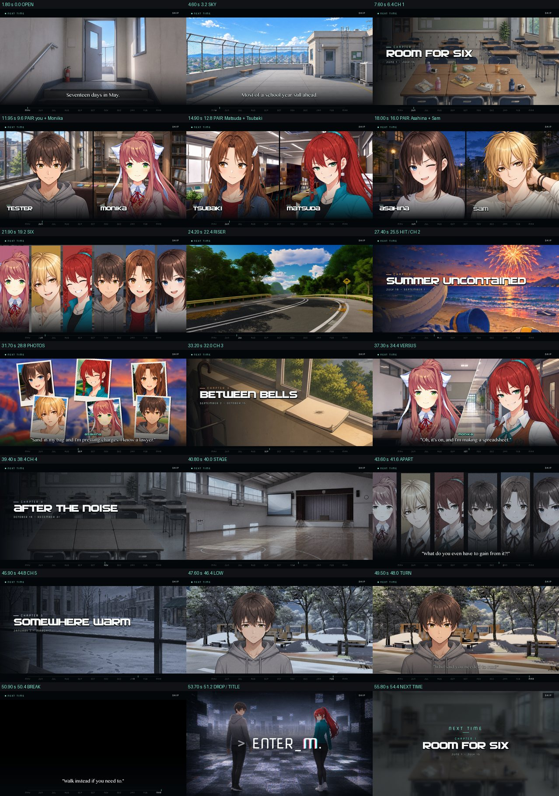

# "Next time" trailer overhaul — October 14, 2026

Superseded by [2026-10-14-next-time-trailer-remake.md](2026-10-14-next-time-trailer-remake.md), which remade this cut the same evening.

The closing trailer of Chapter 0.5 was rebuilt for the first public demo. The
ask: make it eye-catching and representative of the rest of the story without
spoiling it. The old cut was a mood board: about 60 seconds of backgrounds with
one italic line each, OP glitch effects, and no characters on screen.

Source: `game/addons/Next Time Trailer/next_time_trailer.rpy` (rewritten, LF).
New art in the same folder. No other game file changed.

## What it is now

A one-minute season preview cut to `scamall` (75 BPM), on a broadcast frame:
a letterbox, a "NEXT TIME" bug, and a month rail in the bottom bar. The rail's
marker crosses MAY to MAR as the trailer runs. Chapter cards use the public
chapter-select titles over partial crops of the chapter art.

| music (s) | shot |
| --- | --- |
| 0.0 | OPEN: the rooftop door, pushing into the light. "Seventeen days in May." |
| 3.2 | SKY: the roof, tilting up. "Most of a school year still ahead." |
| 6.4 | CHAPTER 1, Room for Six, over the June desks |
| 9.6 | PAIRS, one bar each, sharing a room: you + Monika (library), Matsuda + Tsubaki (bookstore), Asahina + Sam (evening street) |
| 19.2 | SIX: six color slats, one face per eighth note |
| 22.4 | RISER: track at dusk, the city, the bus road, fields, the roof, cutting faster |
| 25.5 | HIT: the crash is the fireworks. CHAPTER 2, Summer Uncontained |
| 28.8 | PHOTOS: six summer snapshots drop in. Asahina: "Sand in my bag and I'm pressing charges. I know a lawyer." |
| 32.0 | CHAPTER 3, Between Bells |
| 34.4 | VERSUS: a diagonal split. Matsuda: "Madam President, I hereby challenge you, formally, with witnesses and everything!" Monika: "Oh, it's on, and I'm making a spreadsheet." |
| 37.6 | SWELL: the camera pushes in; the signal slips for the first time |
| 38.4 | CHAPTER 4, After the Noise: the same desks as Chapter 1, same crop, empty |
| 40.0 | STAGE: the festival stage, after |
| 41.6 | APART: the six slats again, cold, drifting off their marks. "What do you even have to gain from it?!" |
| 44.8 | CHAPTER 5, Somewhere Warm: snow, a cup left on a bench |
| 46.4 | LOW: you, cold, in the winter park |
| 48.0 | TURN: the frame warms. "Who said you needed to run?" / "Walk instead if you need to." (Himeko, 0523:672) |
| 50.4 | BREAK: black in the music's silence; the line holds |
| 51.2 | DROP: the key art and the `> ENTER_M.` wordmark; the letterbox opens |
| 54.4 | NEXT TIME: Chapter 1, Room for Six, June 1 – July 15 |
| 56.8 | Fade and music fadeout; control returns at about 59.4 s |

The sync points come from the cue itself (onset scan of `scamall.ogg`): the
crash at 25.50 s, silence from 50.40 s, and the drop on bar 16 at 51.20 s.

## Decisions

- **Cuts wait on the music's own clock.** `enter_m_tr_at(mark)` holds each shot
  until `renpy.music.get_pos()` reaches the mark, so a slow frame never adds
  drift. Muted audio returns no position, so the wall clock takes over. A save
  loaded mid-trailer restarts the cue at zero; the two clocks then disagree,
  and the shots fall back to their nominal lengths. Ren'Py's built-in
  `pause(music=)` would have stalled about 40 s on the next shot in that case.
- **Close-ups are drawn from the master art.** The registered cast images
  flatten at 640x960, so zooming one upscales that texture. `enter_m_tr_cast`
  takes the layered image's own layer stack and flattens it after the zoom. On
  the same face at x1.6 it measured a quarter sharper, with identical color.
  Face anchors were measured on renders. Monika's DDLC plate draws her face
  1.25x larger than the rest of the cast.
- **Chapter art appears only as partial crops.** The CG gallery rule is "seen
  = unlocked", and these CGs unlock when their chapter is chosen, so the
  trailer calls no `cg_unlock`. Chapter 4 reuses Chapter 1's exact crop on
  purpose.
- **Spoilers.** No silhouettes, and nobody is singled out: every group shot
  takes all six from the same face bank, and Tsubaki is present in every one.
  Sam keeps his pleasant baseline faces (`thinking` in the cold shot, like
  everyone's neutral). Kotonoha and Himeko do not appear, so the Chapter 5 hand
  is not hinted. Himeko's line is unattributed and is one the player has
  already heard. Nothing touches the dependency route.
- **The locked vocabulary.** The prose guide fixes this trailer's atmosphere
  as "mystique, not angelic", "ethereal, not cosmic": broadcast decay, a signal
  that can barely hold. That lives in the frame and a new signal layer
  (`enter_m_tr_signal`). Grain runs from the first frame. Dropout bands and a
  hum bar start at the versus swell and are worst in Chapter 5. The signal
  steadies on the turn, drops out in the silent break, and comes back with the
  title. The summer is warm, as the brief allowed; type always sits above the
  decay.
- **No OP dependency.** The OP folder is excluded from the build
  (`ENTER_M_SHIP_OP = False`). The key art is a copy here. Everything else is
  owned by this file or comes from shipped files: `image noise` (fx.rpy),
  `enter_m_photosensitive()` (accessibility.rpy), and fonts, backgrounds,
  sprites and chapter CGs under `assets/`. The trailer registers no shaders.
- **Photosensitive Mode** takes the light and keeps the picture. Flashes become
  a low, slow swell (peak 0.22 or less). The riser's fast cuts become 0.22 s
  dissolves. Grain holds still, and the flickering bands are dropped.
- **The title is live text.** `assets/gui/logo.png` is an app-icon tile whose
  wordmark is small, so upscaling it would be soft. The title instead sets
  `> ENTER_M.` in NovaSquare, with the logo's red/cyan split on the M as two
  additive copies.

## Lines that left the old cut

The roadmap treats the old trailer's unattributed fragments as seeds for later
scenes. The old cut is in git HEAD (2bc9b7e); its lines were:

- "Don't mind the dark. It's only a preview."
- "Everyone is still smiling."
- "You can stop whenever you want, you know."
- "Look at all of them, while they're still here."
- "What do you even have to gain from it?!" (kept, in Chapter 4)
- "None of it had to happen like this."
- "You're allowed to look away here."
- "WE WERE STILL HAPPY HERE."
- "Some of this is already behind us."
- "I-It doesn't hurt yet..."
- "You...you promised you'd remember this!!!"
- "Spring looks different from here."
- "Hey, nobody has to know about this, you're fine." (cut as a spoiler)
- "Everyone knew. Everyone looked away."
- "I couldn't stop it either."
- The fourth-wall close: "You can read every one of these, can't you?" /
  "You always could, [player]." / "Then do you remember how it ends?" The
  interest audit rates this among the game's best fourth-wall work. It was
  dropped for this cut and could return as a post-title stinger.

## Checks that ran

- **Lint**, isolated (own TEMP, `MATSU_FRESH_RUN`, throwaway `--savedir`, real
  file handles), after every edit: clean. Final report line: "The game contains
  8,702 dialogue blocks, containing 104,732 words and 567,675 characters".
- **Frames**: one screenshot per run, through a probe loaded with
  `RENPY_SEARCHPATH` and a splashscreen override, at a music-clock time. The
  final pass covered 21 times across the whole cut (the sheet above), plus
  Photosensitive Mode frames at 3.35, 24.6, 25.75, 43.0 and 51.4 s. At capture
  the music position and the wall clock agreed within 0.07 s.
- **Exits**, each checking every trailer screen with `renpy.get_screen`, the
  music channel, quick_menu and the master layer after return:
  - normal end (59.5 s);
  - Escape at 12, 44 and 52 s (52 s is mid-title);
  - a click on the SKIP button at 9 s;
  - music muted with the clock invalidated at 22.4 s, standing in for a
    mid-trailer load (it finished in 59.6 s);
  - skip mode switched on. Ren'Py stops skipping at unseen content, so this
    ran full length. The seen-content case, where the pauses pass instantly,
    is covered by a final `stop music` on both exits but was not run.
  All came back clean: no trailer screen, nothing playing, quick_menu restored,
  only `black` on master.
- **Performance**, a full solo run on the 240 Hz panel: 14,231 frames, median
  4.17 ms, p99 4.96 ms, worst 19.1 ms (the six-photo cut). Nothing exceeded
  25 ms. Every spike sits on a cut. The warm-up thread finished before the
  first shot that needed it.
- **Static checks**: no `enter_m_op` or `Sick Ass Anime OP` in the file; no
  duplicate `register_shader` name in the project; no orphan `.rpyc`; the file
  has 0 CRLF.

## Not covered

- Audible sync was judged from the measured onsets and the clock logs, not by
  ear.
- The trailer was driven from a splashscreen probe, not from the real 0531
  ending. The 0531 path differs only in state the caller already clears
  (`hide_calendar()`, `atmos_clear()`, a hidden window). Cast tags are never
  shown, so the story's framing and stage-panel wrappers do not engage.
- Right-click still opens the game menu mid-trailer, as before. The cut
  re-syncs to the music on return.
- The VS Code Ren'Py extension flags `store.enter_m_tr_mark` as "not
  defaulted". It is defaulted in the file; the warning is a false positive.

## Follow-ups for other files (not changed here)

- `docs/project/roadmap.md` ("Continuity to carry forward") points at the old
  fragments. The new cut's promises are a beach trip, a Matsuda/Monika
  challenge, the festival stage, one argument line, and Himeko's line.
- `game/accessibility.rpy`'s header says only Asarhythm reads Photosensitive
  Mode; the trailer now reads it too. The toggle still lives only in
  Asarhythm's settings.
- `docs/story/audits/MAIN_STORY_INTEREST_AUDIT.md` links trailer line numbers
  (#L394, #L525, #L531) and quotes meta lines that no longer exist.
