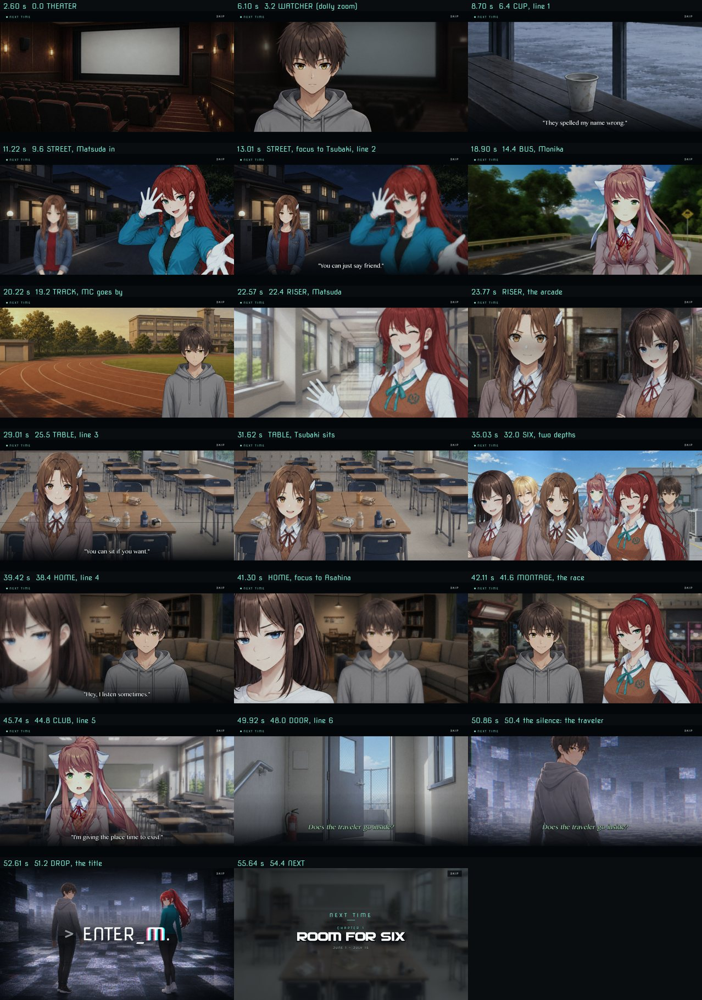

# "Next time" trailer remake — October 14, 2026

This supersedes [this morning's overhaul](2026-10-14-next-time-trailer-overhaul.md).
The Chapter 0.5 demo shipped today with the morning's cut, so this lands in
the patch.

Source: `game/addons/Next Time Trailer/next_time_trailer.rpy` (rewritten, LF).
No other game file changed. Four images in that folder were deleted (see
"Files").

## The ask

The user's words: "the Next Time trailer is way too corny and way too explicit
in spoiling the story. completely remake it with an agent that knows how to make
compelling yet literary trailers that hook the player."

Both charges held up against the file:

- **Corny.** The banter played like a sitcom promo ("Madam President, I hereby
  challenge you, formally, with witnesses and everything!", "Oh, it's on, and
  I'm making a spreadsheet.", "Sand in my bag and I'm pressing charges."). The
  captions used trailer voice ("Seventeen days in May.", "Most of a school year
  still ahead."). There was a VERSUS split and a pair-by-pair cast roll call
  with name tags.
- **Spoiling.** The cut was a table of contents for the season. It showed
  chapter cards 1 to 5 in order with a month rail running May to March. Summer
  was graded warm and winter cold. In Chapter 4 the six slats drifted apart.
  Chapter 5 showed MC cold, then a warm turn on Himeko's line. Watching it
  told you the arc: the group forms and breaks, MC hits bottom in winter, then
  he recovers.

A first pass of this remake fixed the words and the withholding. The user
watched it live in their autoreload build and sent a second note: "still just
still backgrounds without any cinematography. also the first image fades in on
a transparent checker background". The picture was rebuilt from that note;
the words stayed.

## What it is now

One minute cut to `scamall` on the morning's broadcast frame: letterbox, the
NEXT TIME bug and SKIP, with no month rail and no chapter cards. Every shot is
one composited picture on an ink plate, with the camera on the whole. Every
shot wears the same hollow grade, and the year's order is scrambled.

| music (s) | shot | people and motion | words |
| --- | --- | --- | --- |
| 0.0 | THEATER: the dark house and its blank screen, up from black | slow push toward the screen | |
| 3.2 | WATCHER: the reverse, MC in the seats | MC lit by the screen's flicker; the camera pushes in while the room behind slides back faster (a dolly zoom) | |
| 6.4 | CUP: a paper cup on a wet bench by a window (Ch 5 crop) | rack focus onto the cup | 7.4 "They spelled my name wrong." |
| 9.6 | STREET at night, the vending machine | headlights cross; Matsuda backs into frame mid-performance; Tsubaki soft behind; the focus racks to Tsubaki at 12.0 | 12.0 "You can just say friend." |
| 14.4 | BUS: Monika by the window | her private face; the road runs out behind her; a sway; tree shadows; the push lands on her eyes | |
| 19.2 | TRACK: down the lane at evening | the camera gathers speed; MC at the lane's edge goes by faster than the track | |
| 22.4 | RISER: whip-ins on the beat, then the half-beat | Matsuda bursts in laughing; Tsubaki and Asahina lit by an arcade cabinet; the library's sticky notes; Sam; the kitchen at night; Monika | |
| 25.5 | TABLE: six desks, six lunches (Ch 1 crop); the crash, a slam and a cool flash | Tsubaki comes in from the left and stops short; her face turns at 29.6; she sits at 30.4 | 28.2 "You can sit if you want." |
| 32.0 | SIX: all six on the roof | tracked past in two depths, the near row faster than the far; a glare crosses | |
| 38.4 | HOME at night | MC sharp; Asahina soft and half out of frame; the focus racks to her as the line ends | 38.8 "Hey, I listen sometimes." |
| 41.6 | MONTAGE, one per beat | MC and Matsuda at the racing cabinets; the beach towel and inflatable sword (Ch 2 crop); three umbrellas by a window (Ch 3 crop); the club room, wide | |
| 44.8 | CLUB: Monika listening | her face turns on the breath at 47.2; the push lands on her as the line ends | 45.2 "I'm giving the place time to exist." |
| 48.0 | DOOR: up the stairs at a run, the doorway rushing up on the brightest hits | point of view | 48.8 *Does the traveler go inside?* |
| 50.4 | the silence: past the door, the traveler, his back to us in the static, looking round (key art at x2.4) | nothing moves; the signal is gone | the question holds |
| 51.2 | DROP: the camera pulls back to the whole key art; `> ENTER_M.`; the letterbox opens | | |
| 54.4 | NEXT TIME / CHAPTER 1 / ROOM FOR SIX / JUNE 1 – JULY 15 | | |
| 56.8 | fade and music fadeout; control returns at about 59.4 s | | |

The sync points are this morning's measured onsets. I re-scanned the cue
beat by beat for this cut. The band's loudest downbeats fall at 25.6, 32.0,
38.4 and 44.8. Each phrase breathes on the fourth beat of its first bar (28.0,
34.4, 40.8, 47.2). Bar 15's two brightest hits land at 48.8 and 50.0. The
silence runs from 50.40 to about 51.15, and the drop is a lighter, high-heavy
groove rather than a slam.

## The words

Six lines. Every one is already said or written in Chapter 0.5 and is heard on
every route, so **the trailer makes no new promises** and adds no lines to
assign later.

| line | speaker, source | where it plays |
| --- | --- | --- |
| "They spelled my name wrong." | Matsuda, `0531.rpy:305` (the magazine in the bookstore) | over a paper cup somebody left (a name on a cup, spelled wrong) |
| "You can just say friend." | Tsubaki, `0517.rpy:248` (her first line, deflating Matsuda's introduction) | the street where it was said; Matsuda performs, and the focus racks to Tsubaki |
| "You can sit if you want." | MC, `0521.rpy:198` (to Tsubaki on the roof) | Tsubaki at the six-lunch table: she hears it, her face turns, she sits |
| "Hey, I listen sometimes." | Asahina, `0515.rpy:234` (the first evening, on the swing) | MC sharp; his sister at the soft edge of frame until the focus finds her |
| "I'm giving the place time to exist." | MC, `0530.rpy:348` (the directions prompt) | Monika listening, as she was when he said it |
| *Does the traveler go inside?* | Monika's green ink, `0530.rpy:396` and `0531.rpy:1016` | over the climb, then alone with the traveler in the silence |

The last line is MC's homework, due Monday, which falls in Chapter 1. The
chapter's final lines in `0531` leave it open ("I'm still deciding what comes
next", "The door is already open."). The title
`> ENTER_M.` lands on it like a typed answer. Nobody says so, and nobody
addresses the player.

Spoken lines are quoted in the dialogue face, as the game quotes them. The
written line is set in the italic the story uses for notes, in green for
Monika's pen ("the green ink she saves for finished headings", `0530.rpy:311`).
Nobody is named on screen. A face never speaks its own line unless a rack focus
or a landing push hands the line over. Each line plays over the scene it came
from, usually on the face it was said to.

## How it got here

### Paper edit, first instinct

| t | picture | words |
| --- | --- | --- |
| 0.0 | a cup on a bench | "Sometimes I wait to see if you'll spill it." (Monika, `0524.rpy:508`) |
| 6.4 | the road through the bus glass | |
| 12.8 | the blank cinema screen | "They spelled my name wrong." |
| 16.0 | the vending machine at night | |
| 19.2 | stairs to the rooftop door | |
| 22.4 | riser: track, arcade, umbrellas, poster, library | |
| 25.5 | crash: six lunches | "You can just say friend." |
| 32.0 | the six faces | "Sometimes she just guesses right." (Tsubaki, `0523.rpy:457`) |
| 38.4 | the beach and fireworks | "You know you're allowed, right?" (Asahina, `0517.rpy:446`) |
| 44.8 | the stairs again | "I'm giving the place time to exist." |
| 48.0 | the doorway | *Does the traveler go inside?* |

### What the critique changed

- **Monika as frame voice.** Her line opening the trailer plus her ink closing
  it made her the voice that watches "you" and asks whether "you" go in. That
  is DDLC's Monika addressing the player. The author's note at `0515.rpy:20-23`
  calls the meta thread dormant: it "should not promise more than those acts
  pay back." Cut.
- **A seed made undeniable.** "Sometimes she just guesses right" carries the
  author's note "NUDGE KEEP: exactly as written. The first deniable tracking
  beat." (`0523.rpy:451`). A trailer that spotlights it makes it undeniable.
  Cut.
- **The Matsuda thread.** "You know you're allowed, right?" is permission not
  to want Matsuda's texts. Beside a Matsuda line it points at the rupture. Cut.
- **Illustration.** "You can just say friend" over six lunches illustrates the
  picture and leans on the friendship register. It moved to the empty street
  where it was said. The table took an invitation instead.
- **The trailer's own arc.** Opening on a lone cup and ending at a door shapes
  the minute as alone, then arriving. That reads as low, then recovery. The
  opening moved to the blank screen, and the cup went second, cropped so its
  footprints and the old-bank cafe never show.
- **The crash.** Fireworks on the crash are the literal choice and a luminance
  spike. The crash landed on stillness (the six lunches). There are no
  fireworks anywhere.

Other lines were weighed and left out on the same grounds:

- Tsubaki on forgetting or on "next time" (`0521.rpy:189`, `0530.rpy:187`,
  `0531.rpy:565`) would read back as her erasure.
- The sea star (`0525.rpy:141`) and the shadow that is gone one morning
  (`0525.rpy:196`) are collapse and erasure images.
- Kotonoha's "six papers in three days" is a marked Chapter 5 seed
  (`0527.rpy:363`).
- Asahina setting Mom's place (`0530.rpy:563`) is a marked seed for Mom.
- Mom's "Root end stays on. It holds the rest of it together." points at her.
- "Leave it on. I want to hear what happens after the bit I know."
  (`0528.rpy:401`) plays only on the clean exam path.

### The note on the picture

The first build kept the words above and showed them over empty places with
slow pushes. That is the mood board the user had already turned down, and they
said so. The rebuild put the cast in the frame:

- off-center singles in negative space (MC in the theater, Monika on the bus,
  Tsubaki at the table, Monika in the club);
- two-shots with depth where a rack focus decides whose line it is (the
  street, home);
- entrances, a sit and two turns of expression;
- light that moves (a screen's flicker, headlights, glare, tree shadow);
- one dolly zoom;
- a tracked group in two depths with parallax;
- whips into the riser's cuts, and the lane's direction kept across the cut
  into it;
- establishing shots into closer ones (theater, club).

The one figure turned away the art allows is the key art's MC. He became the
traveler in the silence, and the drop pulls back off him to the title. The
checkerboard was the developer build's transparency tile showing through a
fade with nothing under it. Every shot now sits on an ink plate.

## Decisions

- **Withhold the shape.**
  - No chapter cards, months or numbered seasons.
  - One grade for every shot, so no season reads warmer than another.
  - The four chapter crops used (1, 2, 3, 5) are out of order and graded alike.
  - Chapter 4's empty desks, the image of the group gone, are not used.
- **The spoiler policy holds.**
  - No silhouettes.
  - The six appear together once, on everyday faces, with Tsubaki in the group.
  - Sam stays on his pleasant baseline and is always whole in frame. A
    half-hidden Sam would read as a man with something to hide, and the roadmap
    has not decided what he hides.
  - No Kotonoha or Himeko, and no `tsubaki post_*` or `asahina terror` sprites.
  - Nothing from the dependency route or from Chapter 5's specifics.
  - Nothing from the locked Dead Fantasy table:
    `bg living_room_tabletop_night` is that side story's TTRPG set, not Copper
    Crown, so it was rejected as an insert.
- **Chapter CGs appear only as partial crops** with no `cg_unlock`. The Next
  card's Chapter 1 backdrop is deep, blurred and zoomed.
- **The locked vocabulary.** The signal layer stays as built this morning:
  grain throughout, with dropout bands and a hum bar riding the riser and the
  band. It now follows the music's energy, never the story. It is gone in the
  silence and leaves a light grain under the title. The place past the door is
  static and gray, not light: "mystique, not angelic", "ethereal, not cosmic".
- **Photosensitive Mode** takes the light and keeps the picture:
  - screen flicker holds still;
  - headlights and glare dim to about a third and move at half speed;
  - flashes become the existing low, slow swell;
  - the riser's cuts become 0.22 s dissolves.
  The whips' blur is motion, not luminance, and stays.
- **Kept plumbing, unchanged in behavior:**
  - the music clock (`enter_m_tr_at`, with its wall-clock fallback and nominal
    holds);
  - the cleanup list and both exits' contract;
  - the warm-up thread (new art list);
  - the master-art close-up helper and face anchors (pose anchors added);
  - the signal, flash, title and Next screens;
  - the skip screen and the public labels;
  - the 0531 call.
- **The OP-free rule holds.** The key art is this folder's own copy. No
  shaders are registered.

## Files

- `game/addons/Next Time Trailer/next_time_trailer.rpy`: rewritten.
- Deleted from that folder:
  - `split_l.png`, `split_r.png` and `split_seam.png` (the versus mask);
  - `shade_h.png` (the chapter card's shade).
- Kept in that folder: `band.png`, `shade_v.png`, `vignette.png`,
  `titledropalt.png`.
- Docs:
  - this write-up and its frame sheet;
  - a "Superseded by" line on the overhaul write-up;
  - the trailer sentence in `docs/project/roadmap.md` ("Continuity to carry
    forward").
- Snapshot of everything above as it stood before the remake:
  `C:\Users\Admin\ENTER-M-backups\20261014-trailer-remake-before\`.

## Engine findings

1. **A float position is a fraction of the screen.** A pan written as
   `linear t xpos (-1840.0)` threw a 3120-px picture 1840 screen-widths away on
   its first frame. The shot rendered pure black, and lint stayed clean. Pixel
   arguments to ATL positions are ints; offsets are always pixels.
2. **An outer transform that sets a position overrides its child's
   placement.** A Transform inherits unset placement from its child. A push
   wrapped around a crop anchored elsewhere discards the crop. Inner layers
   take only offsets, zoom, blur, alpha and color; the push that frames a shot
   goes on the whole shot.
3. **The developer build tiles a checkerboard behind any transparency**
   (`config.transparent_tile`, drawn by the developer overlay). It shows through
   a fading scene image with nothing under it, and through any crop that leaves
   the frame uncovered. Hence the ink plates and `enter_m_tr_plate`'s coverage
   clamp.
4. **`renpy.screenshot()` renders the last drawn frame.** Called from a
   `config.periodic_callbacks` hook, it captures mid-pause at the moment it
   is asked.

## Checks that ran

- **Lint.** Isolated run (own TEMP, `MATSU_FRESH_RUN`, a throwaway
  `--savedir`, real file handles), after every edit: clean. Final report line:
  "The game contains 8,707 dialogue blocks, containing 104,842 words and
  568,281 characters". The count rose from 8,702 between runs: someone else
  edited story files in parallel. The trailer adds no dialogue blocks.
- **Frames.** One screenshot per run, from a probe loaded with
  `RENPY_SEARCHPATH` (nothing added to `game/`) that overrides the
  splashscreen. Each frame is taken from a `config.periodic_callbacks` hook
  when the music clock reaches its mark.
  - The final cut was captured at 40 times across its length; the sheet above
    is a selection. At capture, the music position and the wall clock agreed
    within 0.07 s.
  - Every frame was looked at. That review caught all of these, and each was
    fixed:
    - a crop placed off its anchor uncovered the frame;
    - the six-face strip rendered black (the float position);
    - two transforms overrode their children's framing;
    - the bus read as standing in the road;
    - the track was an empty plate;
    - a poster insert was pinned to the image edge;
    - the green question was faint over the stairwell floor.
- **Photosensitive Mode.** Eight frames at 0.7, 4.4, 10.7, 22.6, 25.9, 35.5,
  42.1 and 51.5 s:
  - the screen flicker holds still;
  - the headlights and glare are dim;
  - the riser's first cut is a dissolve;
  - the crash and the drop flash as low swells.
- **Exits.** Each run checked, after the trailer returned:
  - every trailer screen with `renpy.get_screen`;
  - the music channel;
  - `quick_menu`;
  - the master layer's tags;
  - a screenshot.

  The runs:
  - normal end, 59.95 to 60.02 s each (every frame, Photosensitive and
    performance run of the rebuilt cut ended this way: 52 runs);
  - Escape at 12.07, 44.03 and 52.01 s (the last mid-title), returning at
    13.1, 45.1 and 53.1 s;
  - a click on SKIP at 9.13 s, returning at 10.2 s;
  - Space at 30.04 s, returning at 31.1 s;
  - the wall clock knocked 5 s out of step at 22.4 s, standing in for a load
    mid-trailer: it finished at 60.08 s on nominal holds.

  All came back clean: no trailer screen, nothing playing, quick_menu
  restored, only `black` on master, and an all-black exit frame.
- **Performance.** A full solo run on the 240 Hz panel:
  - 14,347 frames;
  - median 4.10 ms, p99 5.35 ms;
  - the worst frame was 25.1 ms, at t = 0.0, the trailer's first frame, still
    black;
  - the next worst were 10.5 to 13.5 ms, every one on a cut (the crash, the
    six, the club, the drop, the Next card).
- **Static.**
  - The file has 0 CRLF.
  - There is no orphan `.rpyc` in `game/`.
  - The trailer has no `register_shader`, no OP references and no
    `cg_unlock` call, and only the rules comment mentions Kotonoha or Himeko.
  - No `traceback.txt` is left in the project root. The one a harness race
    wrote was the probe's and was removed.

## Not covered

- Audible sync was judged from the measured onsets and the clock logs, not by
  ear.
- The trailer was driven from a splashscreen probe, not from the real 0531
  ending. The 0531 path differs only in state the caller already clears.
- Right-click still opens the game menu mid-trailer, as before. The cut
  re-syncs to the music on return.
- The probe harness lost runs to its own races, not trailer faults:
  - Twice an instance died at boot on a missing `cache/bytecode-312.rpyb` while
    a sibling instance rewrote it. Both were re-run alone and passed. Their
    `traceback.txt` files in the project root were removed.
  - Earlier, during the first pass, two parallel runs exited mid-trailer with
    no traceback.
  - Launches four at a time are fast but not free.

## Follow-ups for other files (not changed here)

- `game/accessibility.rpy`'s header still says only Asarhythm reads
  Photosensitive Mode; the trailer reads it too.
- `docs/story/audits/MAIN_STORY_INTEREST_AUDIT.md` still links trailer line
  numbers and quotes lines from two cuts ago.
